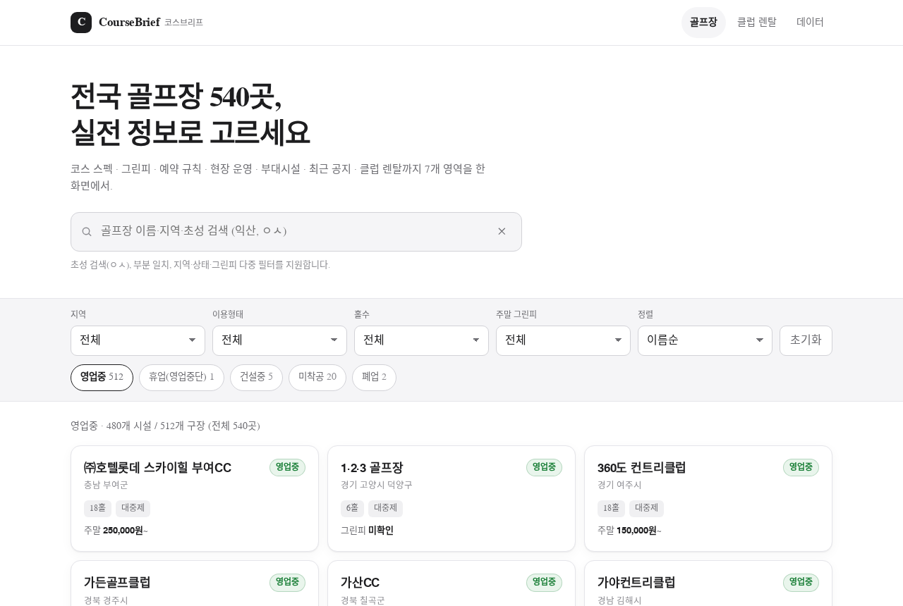
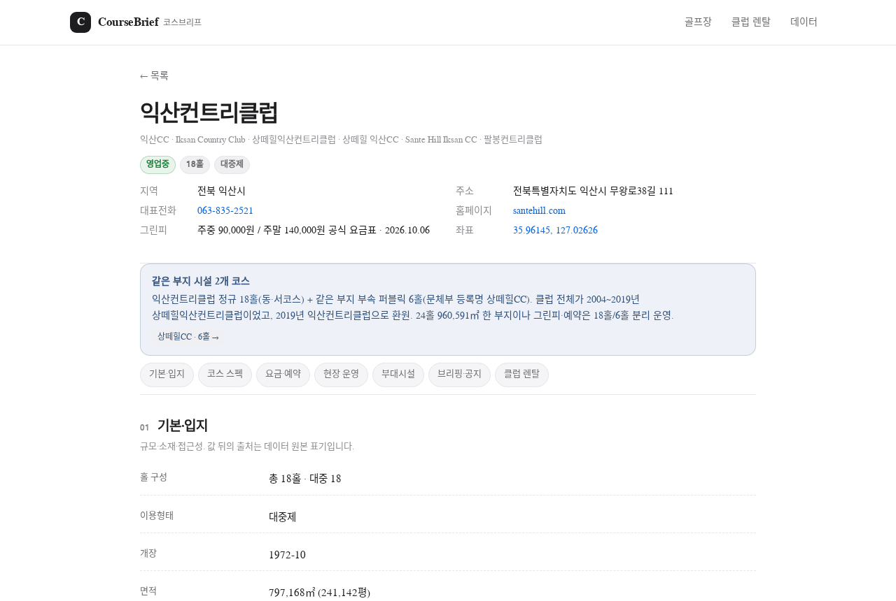
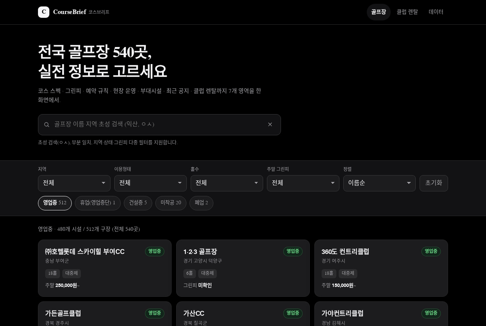

# CourseBrief (코스브리프)

> 전국 **540개 골프장**의 코스 스펙 · 그린피 · 예약 규칙 · 현장 운영 디테일 · 부대시설 · 최근 공지 · 클럽 렌탈을
> **7개 영역**으로 정리한 골프장 실전 브리핑 서비스입니다.
> 정적 웹(Cloudflare Pages, 0원)과 React Native 앱이 **같은 JSON 데이터**를 그대로 사용합니다.

- 웹: **TypeScript** 소스 → esbuild 번들, 런타임 의존성 0의 정적 사이트 (`dist/`) — PC·모바일 반응형, 라이트/다크 테마(기본은 시스템 자동, 헤더에서 수동 전환)
- 데이터: `data/v29/` — 540곳 경량 인덱스 + 구장별 상세 540개 JSON (타입: `shared/types/`, 웹·RN 공용)
- 검색: 브라우저 정적 검색(초성·부분일치·다중 필터) 기본, Elasticsearch(nori) 어댑터 선택 장착 (`SearchAdapter` 계약은 `shared/types/search.ts`, `web/assets/search.ts`)

| 목록 (라이트) | 상세 | 목록 (다크) |
| --- | --- | --- |
|  |  |  |

---

## 1. 무엇을 보여주나 — 7개 영역

| # | 영역 | 담는 것 | 대표 필드 |
| --- | --- | --- | --- |
| 01 | **기본·입지** | 소재·규모·개장·운영사·좌표·최단 IC | `master.address`, `area_sqm`, `opened`, `operators`, `nearest_ic` |
| 02 | **코스 스펙** | 홀 구성·파·전장·잔디·KGA 코스레이팅/슬로프 | `course.holes/par/length_m`, `grass`, `kga.hole_combinations` |
| 03 | **요금·예약·취소** | 주중/주말 그린피·카트·캐디·예약 오픈 주기·위약·악천후 정산 | `fee.*`, `cancel.*` |
| 04 | **현장 운영** | 노캐디·2/3/5인·카트 종류와 진입·셀프 백드롭·매트·체크인·복장 | `ops.*` (14항목, `value`+`evidence`) |
| 05 | **부대시설** | 연습장·식당·그늘집·락카·사우나·숙박·야간 조명·셔틀·전기차 | `facilities.*` |
| 06 | **브리핑·공지** | 휴장·에어레이션·요금 변경 공지, 라운더 평가, 확인 필요 알림 | `briefing.notices`, `alert`, `review` |
| 07 | **클럽 렌탈** | 골프장 자체 대여 + 해외 골퍼용 렌탈·딜리버리 업체 8곳 | `rental.*`, `rental_providers.json` |

각 값에는 **출처와 확인 시점**이 데이터로 붙어 있고, 확인하지 못한 값은 `null`로 보존합니다. 일반 화면에는 **확인된 값만** 표시하고, 확인하지 못한 항목은 관리자 모드에서 `미확인`으로 남깁니다.
"정보 없음"을 "없음"으로 해석하지 않는 것이 이 데이터의 기본 규칙입니다.

## 2. 주요 기능

- **검색** — 이름·이명·지역, **한글 초성**(`ㅇㅅ` → 익산·인서울), 부분 일치, 공백 다중 토큰 AND
- **필터** — 지역(17개 시도) · 이용형태 · 홀수 · 주말 그린피 상한 · **플레이 조건 8종**(노캐디·2인·야간·사우나·숙박·셔틀·연습장·식당, 다중 AND) · 정렬(이름/그린피/홀수/**4인 총액**/**평점**) · 조건·정렬·보기 상태가 URL 해시에 남는다
- **지도 뷰** — 목록/지도 전환. Leaflet + OpenStreetMap 타일(키 없음)을 처음 열 때만 내려받고, 국가 배율은 묶음→확대하면 개별 그린피 핀. 라이트/다크 대응, 좌표 539곳
- **총비용 계산기(상세)** — 인원 2·3·4·5 / 주중·주말 / 18·9홀 / 카트·캐디 → 팀 합계·1인당. 없는 값은 `미확인`으로 빼고 "미확인 항목 제외 합계"로 표기. 정산 문구 복사·공유
- **라운드 플래너(상세)** — 라운드 예정일 하나로 **취소 마감·위약**(H2) · **예약 오픈일**(H3) · **날씨**(M1)를 함께 계산. 공휴일은 주중/주말을 직접 바꿀 수 있고, 취소 마감·오픈 일정은 `.ics`(오픈 30분 전·취소 2시간 전 알림)로 내려받는다
- **휴장·정비 캘린더** — 확인된 운영 알림(`alert` 38곳)과 공지 제목에서 기간을 읽은 항목을 한 화면에. 진행 중/예정/일정 미상/지난 일정으로 나누고 권역·종류·관심 골프장 필터
- **관심 골프장** — 카드·상세의 ★로 저장(브라우저 localStorage) + 최근 본 20곳. 저장한 구장의 다음 토요일 라운드 예약 오픈일과 휴장 일정을 목록과 같은 카드로 한 화면에, JSON 내보내기·전체 삭제
- **라운드 준비 카드** — 전날/당일 확인용 한 장(일정·장소·4인 정산·현장·시설·날씨). `인쇄`(print CSS)·`링크 복사`·캘린더 저장
- **값 신선도(90일)** — 요금·공지 확인일이 90일을 넘으면 카드·상세에 `90일+`·`n일 전 확인 · 재확인 권장`을 절제해 표시
- **후보 비교** — 최대 4곳 담기(하단 바) → `#/compare?ids=…` 표(그린피·4인 총액·카트/캐디·2인/노캐디/야간·취소·예약 오픈). 링크 복사로 동반자와 공유
- **예약 채널** — 공식 홈페이지·전화 외 카카오골프예약·골프존 티스캐너·스마트스코어·티픽·네이버 검색으로 바로 이동(예약 대행 아님)
- **상태 배지·필터** — 영업중 / **휴업(영업중단)** / 건설중 / 미착공 / **사업 취소** / 폐업
- **시설 클러스터 묶음** — 같은 부지 복수 코스를 목록에서 한 항목으로(`익산컨트리클럽 (24홀)`), 상세에서는 코스·예약 창구 분리를 명시
- **7개 영역 상세** — 영역별 앵커 내비게이션, 값별 근거 접기, 영역별 정보 충실도(coverage)
- **렌탈 탭** — 권역별 배송 가능 업체, 요금·브랜드·언어·연락처
- **테마** — 기본은 OS·브라우저 설정을 따르는 시스템 자동. 헤더 오른쪽 버튼으로 `시스템 → 라이트 → 다크`를 돌려 선택하면 `localStorage`(`coursebrief-theme`)에 저장돼 새로고침·재방문에도 유지된다. 선택은 `html[data-theme]`로 적용되고, 첫 페인트 전 `index.html` 인라인 스크립트가 먼저 칠해 깜빡임이 없다.
- **출처는 관리자 모드 전용** — 일반 화면에는 구장별 **업데이트 날짜**(`YYYY.MM.DD`)만 보이고, 출처·근거 원문·채움률·스키마 같은 수집 정보는 **렌더링되지 않는다(DOM 에도 없음)**. 푸터의 작은 `관리자` 버튼 → 비밀번호를 넣으면 관리자 모드가 켜져 출처가 보이고, 배지의 `해제` 로 되돌린다(상태는 `localStorage.coursebrief-admin`). 비밀번호는 평문 없이 SHA-256 해시만 코드에 두고 `crypto.subtle` 로 비교한다(`web/assets/admin.ts`).
- **위치·교통(상세 03)** — 주소 복사 · 지도 앱 3종(네이버·카카오·구글) 길찾기 · 최단 IC·거리 · 좌표 복사 · 주차 · 셔틀·교통. 확인된 값만 적고, 없는 항목은 숨기지 않고 `미확인`으로 두고 전화 확인을 안내한다
- **데이터 QA 대시보드(관리자)** — `#/admin-qa`: 540곳 × 7영역 히트맵(채움률), 충실도 분포, 값이 90일 넘은 구장, 취소·오픈 규정 파싱 실패, `미확인 집중`·`주차 미확인`·`요약 데이터만` 필터, CSV 복사
- **정보 오류·누락 제보** — `#/report`: 구장·항목·내용을 적으면 **GitHub 이슈 작성 페이지**(제목·본문 프리필)를 열고, 로그인 없이 보낼 수 있게 `내용 복사`도 제공한다(백엔드 없는 정적 사이트의 정직한 접수 방식)
- **검색·공유 최적화** — 구장별 프리렌더 HTML(`/c/{id}/`)에 `og:title·og:description·og:image`·`canonical`·JSON-LD(`GolfCourse`)를 넣고, `sitemap.xml`(541 URL)·`robots.txt` 로 540곳 롱테일 유입을 연다. 프리렌더 페이지는 정적 요약을 먼저 보여 준 뒤 `#/c/{id}` SPA 로 이어진다(해시 라우팅 100% 호환)
- **공유 카드 이미지** — 구장명·지역·홀수·이용형태·주중/주말 그린피를 담은 1200×630 PNG 540장(`web/og/`) + 기본 커버. `python3 scripts/gen-pwa-assets.py` 로 다시 만든다(빌드에는 Python 을 쓰지 않는다)
- **오프라인(PWA)** — 홈 화면 추가(manifest·아이콘), Service Worker 가 앱 셸·`index.json`·최근 본 구장 JSON 을 캐시, 오프라인 배너와 `새 버전 있음 — 새로고침` 안내. 캐시 이름에 빌드 버전이 들어가 새 배포는 옛 캐시를 지운다
- **접근성·디자인** — Apple HIG / Material 기본 중성 배경, `prefers-color-scheme` 자동, 키보드 포커스, 44px 터치 타깃

## 3. 데이터

```
data/v29/
├── index.json              540곳 경량 인덱스 (약 200KB)
├── courses/{id}.json       구장별 상세 12키 JSON 540개 (상세 515 + 요약 25)
├── clusters.json           시설 클러스터 28개
├── alerts.json             휴장·에어레이션·요금 변경 통합 캘린더 99건(기간 확인 28)
├── booking_rules.json      취소 마감·예약 오픈 계산용 경량 요약 454곳
├── sido.json               시도 코드·건수
├── rental_providers.json   렌탈·딜리버리 업체 8곳
├── rental_deliveries.md    렌탈 시장 조사 원문
└── schema.md               상세 스키마·규칙 문서
data/source/                통합 원본 v2.9 (재생성용)
```

- **상태 분포**: 영업중 512 · 휴업 1(아벨CC) · 폐업 2 · 건설중 5 · 미착공 19 · 사업 취소 1(대전 금고동, 2026-09 백지화)
- **행정구역**: 경기 151, 강원 66, 경북 53, 전남광주 48, 충북 43, 경남 41, 충남 34, 제주 30, 전북 28, 인천 14, 부산 10, 대구 7, 울산 7, 대전 4, 광주 4, 세종 3, 서울 1
- 스키마·값 표기 규칙·`F020` 클러스터·`suspended` 처리: **[data/v29/schema.md](data/v29/schema.md)**

### 소비 예시 (웹·RN 공통)

```ts
import type { CourseIndex, CourseDetail } from "./shared/types";

const base = "https://<your-domain>/data/v29";

// 목록: 한 번에 540곳
const index = (await fetch(`${base}/index.json`).then(r => r.json())) as CourseIndex;
const { courses, clusters } = index;

// 상세: 필요한 구장만
const detail = (await fetch(`${base}/courses/kr-golf-0498.json`).then(r => r.json())) as CourseDetail;
detail.fee.weekend;          // 140000
detail.ops.nocaddie?.value;  // null이면 화면에서 행을 숨김(관리자 모드에서만 "미확인")
```

타입은 `shared/types/` 한 곳에 모여 있습니다(`course.ts` 12키 스키마·인덱스, `cluster.ts`, `rental.ts`,
`search.ts` 검색 어댑터 계약, `cloudflare.ts` Pages Functions). 웹과 React Native 가 같은 계약을 씁니다.

## 4. 로컬 실행

요구 사항: **Node 20+**. 빌드 도구(TypeScript·esbuild)만 devDependencies 이고, 사이트 런타임 의존성은 0입니다.

```bash
npm ci             # package-lock.json 기준 설치
npm run typecheck  # tsc --noEmit (web + Cloudflare Pages Functions, strict)
npm run build      # typecheck 통과 후 web/*.ts 번들 + data/v29 → dist/
npm run preview    # http://localhost:4173
npm run verify     # 산출물 검증(개수·무결성·개인정보·용량·TS 구조)
npm run check      # build + verify
```

```
web/assets/app.ts     화면·라우터·렌더링
web/assets/rules.ts   취소 마감·예약 오픈 날짜 계산 + .ics 생성
web/assets/roundplan.ts 상세 라운드 플래너(H2·H3·M1)
web/assets/weather.ts Open-Meteo 예보·적합도(실패 시 조용히 숨김)
web/assets/alerts.ts  휴장·정비 캘린더(M3)
web/assets/saved.ts   즐겨찾기·최근 본(M4, localStorage)
web/assets/prep.ts    라운드 준비 카드(M5, 인쇄)
web/assets/admin.ts   관리자 모드(출처 노출 분기·비밀번호 해시 비교)
web/assets/location.ts 위치·교통(M2) — 지도 딥링크·주차·셔틀, 미확인 표기
web/assets/qa.ts      데이터 QA 대시보드(M6, 관리자)
web/assets/report.ts  정보 오류·누락 제보(M6) — GitHub 이슈 프리필
web/assets/pwa.ts     오프라인 등록·배너(M8)
web/assets/search.ts  SearchAdapter 구현(LocalSearchAdapter / EsSearchAdapter)
web/assets/util.ts    포맷·초성·이스케이프
shared/types/         웹·RN 공용 타입 (12키 상세·인덱스·클러스터·렌탈·검색 계약)
functions/api/search.ts  Cloudflare Pages Function (ES 프록시, PagesFunction<SearchEnv>)
```

`web/` 아래 `.js` 소스는 없습니다(전부 `.ts`). 빌드 산출물 `dist/assets/app.js` 는 esbuild 번들입니다.

데이터를 다시 만들려면(원본 `data/source/golf_courses_all_v29.json`):

```bash
npm run data:build   # data/v29/* 재생성 (Python 3)
npm run data:rules   # 취소·예약 오픈 문장 파싱 → parsed_cancel·parsed_open, alerts.json·booking_rules.json
npm run data:check   # 12키·개수·금지 문자열·인덱스 300KB 검증
```

### 3단계 산출물 (M2·M6·M7·M8)

```
dist/
├── c/kr-golf-NNNN/index.html   540장 프리렌더 — 구장별 og·canonical·JSON-LD(GolfCourse) + 정적 요약
├── sitemap.xml                 홈 + 540곳 = 541 URL (robots.txt 에 Sitemap 연결)
├── sw.js                       Service Worker — 앱 셸·index.json·최근 본 구장 JSON, 캐시 이름 = 빌드 버전
├── manifest.webmanifest        홈 화면 추가(standalone) · 아이콘 3종+apple-touch
├── og/{id}.png                 구장별 공유 카드 1200×630 (cover.png 포함 541장)
├── icons/*.png                 PWA 아이콘(192·512·maskable·apple 180)
└── data/v29/qa.json            관리자 QA 인덱스 540행 — 영역별 채움률·요금/공지 신선도·파싱 여부
```

프리렌더 HTML 은 `dist/index.html` 한 장을 복제해 `<head>` 메타·`#view-detail` 미리보기만 바꾼다
(`<base href="/">` + `history.replaceState('/#/c/{id}')`). 그래서 클라이언트 렌더와 같은 셸·같은 데이터
포맷을 쓰고, 해시 라우팅(`#/c/{id}`)은 그대로 동작한다.

롤백(3단계 직전 = `pre-stage3` 태그 `d0f2fcc`):

```bash
git reset --hard pre-stage3 && git push --force-with-lease origin main   # 배포 되돌리기
```

Cloudflare Pages 대시보드 → Deployments → 직전 배포 → **Rollback** 으로도 즉시 되돌릴 수 있다
(빌드를 다시 돌리지 않는다).

## 5. 배포 — Cloudflare Pages (무료)

1. Cloudflare Dashboard → Workers & Pages → **Create → Pages → Connect to Git** → 이 저장소 선택
2. Build command `npm run build`, Build output directory `dist`, Root directory `/`
3. 배포 후 `https://<project>.pages.dev` 에서 바로 서비스

`dist/_headers` 에 보안·캐시 헤더가 포함되어 있습니다.
커스텀 도메인은 Pages → Custom domains 에서 연결합니다.

## 6. 검색 구조

```
shared/types/search.ts   SearchAdapter (인터페이스)
web/assets/search.ts
    ├─ LocalSearchAdapter : 정적 JSON 브라우저 검색 (기본, 0원)
    └─ EsSearchAdapter    : Elasticsearch 프록시 호출 (선택, 실패 시 자동 폴백)
functions/api/search.ts  ES 프록시 (PagesFunction<SearchEnv>)
```

ES 를 붙이려면 `elasticsearch/` 의 매핑·적재 스크립트와 `functions/api/search.ts` 프록시를 사용합니다.
절차는 **[elasticsearch/README.md](elasticsearch/README.md)** 참고.

```js
window.COURSEBRIEF_CONFIG = { search: { mode: "es", endpoint: "/api/search" } };
```

## 7. React Native 앱 확장

웹과 동일한 정적 JSON 을 그대로 쓰면 별도 서버가 필요 없습니다.

- 목록: `index.json` 1회 로드(~200KB) → 메모리 검색·필터 (`shared/types` 를 그대로 import, `LocalSearchAdapter` 로직 이식 가능)
- 상세: `courses/{id}.json` (평균 12KB) — 필요할 때만 fetch, AsyncStorage/SQLite 캐시 권장
- 이미지·지도는 좌표(`lat`,`lng`)만 있으면 되고, 외부 API 키는 앱에 넣지 않습니다
- `data/v29/index.json` 의 `built_at`·`version` 으로 캐시 무효화 판단

## 8. 출처·라이선스

| 구분 | 내용 |
| --- | --- |
| 마스터 | 문화체육관광부 「전국 골프장 현황」(2024-12-31 기준, 공공데이터포털) — **이용허락범위 제한 없음** |
| 코스 레이팅 | 대한골프협회(KGA) 코스레이팅™/슬로프레이팅™ 공개 조회 (2026-11-25) |
| 상세 정보 | 각 골프장 **공식 홈페이지·공지사항·요금표** 공개 정보, 공개 예약 채널의 관측 가격 |
| 렌탈 | 업체가 공개한 요금·연락처 (공개 웹 조사, 2026-11-26) |
| 코드 | MIT (데이터는 위 출처의 조건을 따름) |

수록된 전화번호는 **골프장·업체가 공개한 사업자 연락처**이며, 개인 계정 정보는 포함하지 않습니다.

## 9. 주의

- 요금·운영 정보는 **수집 시점의 공개 정보**입니다. 골프장 정책에 따라 수시로 바뀌므로 예약·결제 전 공식 채널에서 최종 확인하세요.
- 이 서비스는 **예약·결제를 대행하지 않습니다.** 읽기 전용 정보 서비스입니다.
- 공지 본문이 이미지인 골프장은 제목·날짜만 수록되어 있을 수 있습니다.
- 정보 오류·누락 제보는 이슈로 남겨 주세요. 확인 후 데이터와 `schema.md` 를 함께 갱신합니다.
